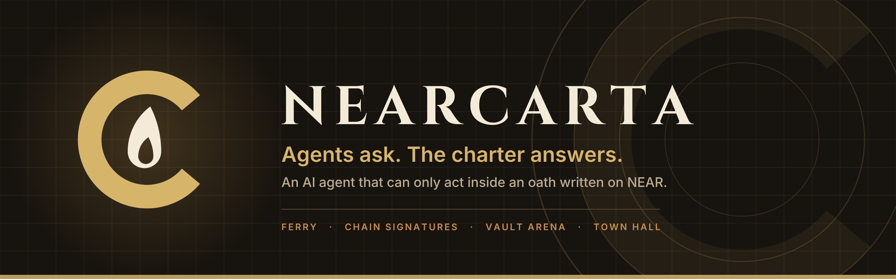

  

<h3 align="center">A game town on NEAR mainnet. Your AI agent runs your errands from shop to shop, and a contract it cannot change decides every payment.</h3>

  <a href="https://nearcarta.vercel.app"><b>Play</b></a> ·
  <a href="https://nearcarta.vercel.app/?net=testnet"><b>Try free on testnet</b></a> ·
  <a href="https://github.com/nearcarta/nearcarta#readme"><b>README and proofs</b></a> ·
  <a href="https://nearcarta.vercel.app/judge"><b>Proof page</b></a>

  
  
  

---

**The problem.** An AI agent can be talked into paying the wrong person.

**Nearcarta.** The payment rules live in one row on `board.nearcarta.near`: who the agent may pay, how much per payment, how much per day, until when. The agent's key can only ask. Every payment is allowed, refused with a reason anyone can open on nearblocks, or held for the owner.

**The game.** Market Day walks the agent through nine shops, each one a real NEAR dApp: Town Hall, Ferry, Toll Bridge, Guardhouse, Vault Arena, Mist Bank, Payouts, Your House and Chronicle. Nine keeper NPCs with their own sub-accounts and capped rows trade with each other on NEAR AI decisions and vote market rules as an on-chain council. The city pays the players' gas.

| Built on NEAR | Where |
|---|---|
| Chain Signatures | The Toll Bridge pays out on Base mainnet, signed by `v1.signer` |
| NEAR Intents (1Click) | The Ferry swaps from the agent's capped row |
| NEAR AI Cloud (TEE) | Keeper decisions and the private Mist Bank audit, attestation checked live |
| NEP-245, NEP-171, NEP-366 | Market goods, house deeds with a purse, gas-free relayed moves |
| Function-call keys | The agent's key can call the board's ask methods and nothing else |

| Repo | What it holds |
|---|---|
| [`nearcarta`](https://github.com/nearcarta/nearcarta) | Contracts, API, the 3D town, tests (1,601 in CI) and every mainnet proof |
| [`.github`](https://github.com/nearcarta/.github) | This profile and the brand files |

Built for NEAR HACKATHON 2026. Independent project, not affiliated with NEAR Foundation.
