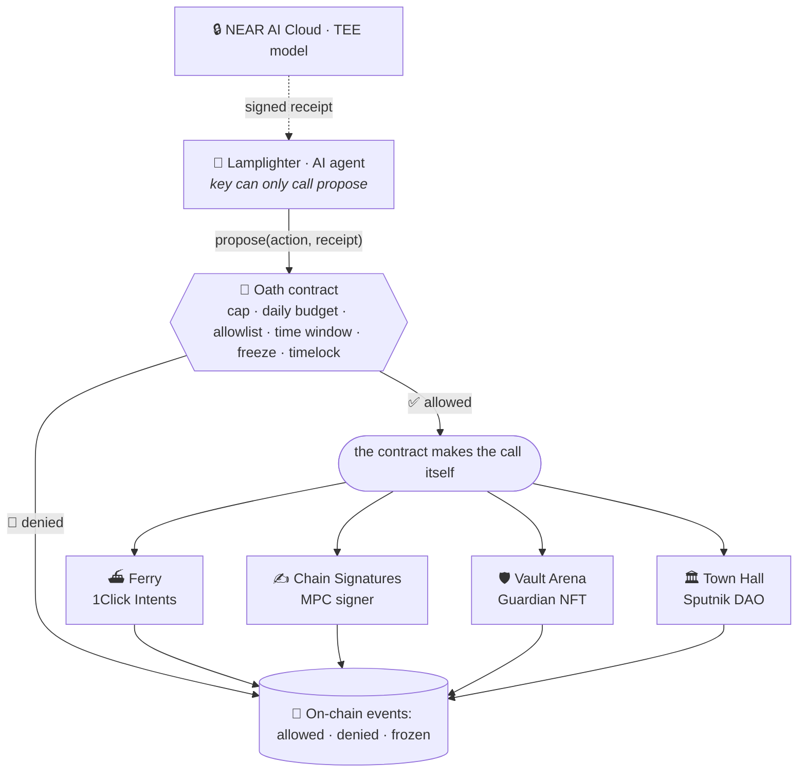

  

<h3 align="center">An AI agent that can spend, swap and sign, but only inside an oath written into a NEAR contract.</h3>

  
  
  
  

---

## 🕯️ Why

AI agents now hold money. Today there are two ways to let one pay, and both are bad:

| Option | What goes wrong |
|---|---|
| 🔑 Give the agent a key | One bad prompt or one stolen key can drain the account |
| 🙋 Make a person approve every action | The agent stops being an agent. People click "approve" without reading |

**Nearcarta moves the approval into a contract.** The owner writes the rules once, as an *oath*. The agent can only *ask*. The contract answers yes or no on chain, makes the payment itself, and leaves a receipt either way.

## 🏘️ The town

One agent, **the Lamplighter**, walks between four shops. Every request it makes goes through the oath first.

| | Shop | What the agent does there | Built on |
|---|---|---|---|
| ⛴️ | **Ferry** | Swaps and sends across chains, inside the oath's limits | NEAR Intents · 1Click API |
| ✍️ | **Chain Signatures** | Signs for its own address on another chain. The contract writes the transaction | NEAR Chain Signatures (MPC) |
| 🛡️ | **Vault Arena** | Guards an NFT that holds a pot. Players try to talk it into breaking the oath | NEP-171 · NEP-245 |
| 🏛️ | **Town Hall** | Pays rewards for a DAO. The DAO can vote to freeze it | Sputnik DAO v2 |

## 🧭 How it works

1. **The agent holds no spending key.** Its only key is a function-call key that can call `propose` on the oath contract. Nothing else.
2. **The oath decides.** It checks the request against the clause (cap, daily budget, receiver allowlist, time window, freeze). If the answer is yes, the contract sends the payment itself.
3. **A "no" is a successful transaction.** It is logged as an event that names the reason.
4. **People keep the brakes.** The owner or a DAO can freeze the agent or revoke its key. Only the DAO can unfreeze it. Rule changes that widen what the agent can do wait in a timelock.

## 🔗 Proofs on chain

> [!NOTE]
> These are **research spikes on test networks**, run in October 2026, before the hackathon build window opens on 1 November. Every row was re-checked against the chain on **28 Oct 2026**.

| | What happened | Result | Tx |
|---|---|---|---|
| 🔐 | Oath account's full-access key deleted. The only key left can call `propose` | ✅ key list checked | [2WyiCa…](https://testnet.nearblocks.io/txns/2WyiCazxV1JTLYKRz6QzU7YaFh4etp3WwQqv5Z8Le3TL) |
| ✅ | Agent asks to pay an allowlisted shop 0.01 NEAR, with a valid receipt | `allowed` | [9zQenp…](https://testnet.nearblocks.io/txns/9zQenpg2yjs3xYd6SQ3UMHqW72ppNB1SW25xXUf7Y6ff) |
| 🚫 | Same request with a forged receipt | `denied` · `receipt_verdict_not_allow` | [DUhFvC…](https://testnet.nearblocks.io/txns/DUhFvCq15nV9cMa5hzLeFWUPs1uF2sZjYD2CZd4BTB7F) |
| 🚫 | Agent tries to pay a new receiver while that rule change is still in the timelock | `denied` · `receiver_not_allowlisted` | [573gVw…](https://testnet.nearblocks.io/txns/573gVwsp2Fbyzmffbo6CbZ8C9TwPaKpAHHeF8ym5jJii) |
| ⏳ | Rule change executed before its time | fails · `ERR_TIMELOCK_NOT_READY` | [rpvix4…](https://testnet.nearblocks.io/txns/rpvix4gCgNzJmDSLLgGWtN1tvkk7BU7uyWhyYGwni4V) |
| ⏳ | Rule change executed after its time | applied · policy v7 | [AyAebu…](https://testnet.nearblocks.io/txns/AyAebuTgms1rYufGohyRYmMVDQ16L77RVM9cKAYTFLA3) |
| 🧊 | Owner tries to lift a DAO freeze | fails · `ERR_DAO_ONLY_UNFREEZE` | [9a2Aqa…](https://testnet.nearblocks.io/txns/9a2AqaPVuFcPegRue67ycdfEuwz4k6RaWJaogDpQiak7) |
| ✍️ | Oath contract writes a Base Sepolia tx and gets an MPC signature | `signed` | [ErwqgH…](https://testnet.nearblocks.io/txns/ErwqgHH5br68jK1qz2ZAsfQpankMHke4CMUjruEtbt3s) |
| ⛓️ | That exact tx (same to, value, nonce) confirmed on Base Sepolia | status 1 · block 51,098,329 | [0xf7ed64…](https://sepolia.basescan.org/tx/0xf7ed6482a8380c1fe84be32973256d00960f522cd0d70fe9fe16165190dbc43b) |
| 🚫 | Sign request to a receiver outside the oath | fails · no MPC call | [88tRkq…](https://testnet.nearblocks.io/txns/88tRkqz9RLMEXd7kAegyQZsozfGMs4CYDrgMjpDCPnCE) |
| 🛡️ | Vault Arena: a player's prompt pushes the agent to pay out 5 NEAR | refused · `C1_CAP` | [7ci2TX…](https://testnet.nearblocks.io/txns/7ci2TXx5Um6AWqpsNWq23wLnyvAoJJCsGis4oV8oekdn) |
| 🏛️ | Sputnik DAO vote freezes the agent | `frozen` | [85iz99…](https://testnet.nearblocks.io/txns/85iz99RxzmmYsn5DvSYsXLjD124tgYBqrsCvgtw6Fzy4) |
| 🏛️ | Agent's next reward call | fails · `ERR_FROZEN` | [9X2Yza…](https://testnet.nearblocks.io/txns/9X2Yza6z2KCJ7qKh4qLN993ztpRVNKxJekbzRKvJuxhA) |

## 🎯 Hackathon tracks

| Track | What Nearcarta shows | Where it stands |
|---|---|---|
| **06 · AI Security & Defense** | Spending caps, a policy engine and a key that cannot pay anyone directly | ✅ testnet txs above · 10 attack tests pass |
| **03 · Privacy & Private AI** | The agent's model runs in NEAR AI Cloud's TEE. Payouts in ZEC go to a shielded address | 🟡 see notes below |
| **10 · NFTs That Do Something** | A Guardian NFT that owns a pot and an agent, bound by its own oath | ✅ testnet refusals · 14/14 unit tests |
| **12 · Social Money** | A DAO pays through the agent and can freeze it by vote | ✅ testnet txs above |
| 🌉 **Cross-chain** | Chain Signatures for other chains; NEAR Intents 1Click for swaps | ✍️ signed and confirmed on Base Sepolia · ⛴️ quotes only, no swap yet |

<b>🔒 Private AI: what is checked, and what is not yet</b>

- ✅ NEAR AI Cloud's attestation token was verified off-chain (Intel Trust Authority signature, TCB `UpToDate`, debug off).
- ✅ In a local sandbox, a contract verified that token (41.1 Tgas) and a full Intel DCAP quote (about 417 Tgas). Not deployed to testnet yet.
- ✅ Checking a model receipt's ed25519 signature on chain costs 1.84 Tgas. Tested so far with a bad signature, which is rejected.
- ⏳ A real signed receipt has not been checked yet. It needs an API key.
- ⚠️ GPU evidence is checked off-chain only. Only models served inside the TEE count as private inference.

<b>🛡️ ZEC payouts: what is checked, and what is not yet</b>

- ✅ The 1Click API accepts a Zcash unified address that holds only an Orchard receiver (dry quote).
- ✅ Public mainnet bridge transactions show NEAR Intents withdrawals to Orchard-only addresses landing as shielded Zcash outputs, in the Orchard-protocol Ironwood pool, with no transparent output to the receiver.
- ⏳ Our own payout has not been sent yet. It needs one small mainnet swap.
- ⚠️ The deposit side is transparent, so a payout can be matched by amount and time. The swap relies on the Intents bridge and its MPC signers.

## 🧱 Security model

| Layer | Guarantee |
|---|---|
| 🔑 Agent key | Function-call key, `propose` only. It cannot send funds or call anything else |
| 📜 Oath | The agent only proposes. The contract checks it and sends the payment from its own account |
| 💸 Limits | Per-action cap, daily budget, daily action count, receiver allowlist, time window |
| ⏳ Rule changes | A change that widens a clause waits in a timelock. Owner or DAO can cancel it |
| 🧊 Freeze | Owner or DAO can freeze or revoke the agent key. Only the DAO can unfreeze |
| 🧾 Receipts | Every decision is a NEP-297 event with the clause and the reason |

**Tested:** 10 exploit tests pass on the hardened contract and all 10 fail on the earlier version. Mutation testing: 139 of 180 mutants caught, 33 unviable, **8 missed**.

**Known limits**

- 🧪 Testnet only. No external audit yet.
- 🧬 8 mutants survive. Their tests still need to be written.
- ⛴️ Ferry has only fetched quotes. No 1Click swap has run.
- 🔒 The positive AI-receipt path and on-chain DCAP are not on testnet yet (see the notes above).
- 🕵️ ZEC payouts are shielded on the Zcash side only. The deposit is public.
- 🤝 Cross-chain steps trust NEAR's MPC network and the Intents bridge.

## 🗂️ Repositories

| Repo | What it holds | Status |
|---|---|---|
| [`.github`](https://github.com/nearcarta/.github) | This profile and the brand files | ✅ live |
| `nearcarta` | Oath contract, the town web app and the four shops | 🗓️ planned, built from 1 Nov |

## 🗓️ Roadmap

| Date (UTC) | Step |
|---|---|
| **1 Nov 2026** | Hackathon opens. The build starts |
| **1 to 14 Nov** | Oath contract, town web app, four shops, testnet first |
| **14 Nov, 23:59** | Submission closes |
| **16 to 18 Nov** | Judging and results |

---

Independent project, not affiliated with NEAR Foundation.
